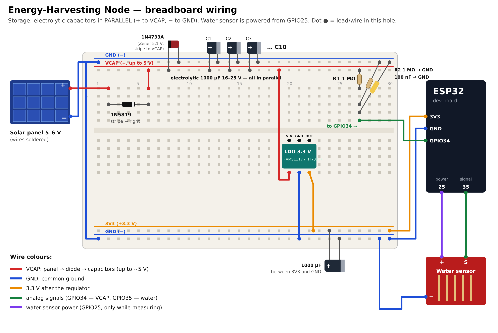
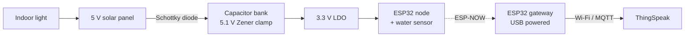
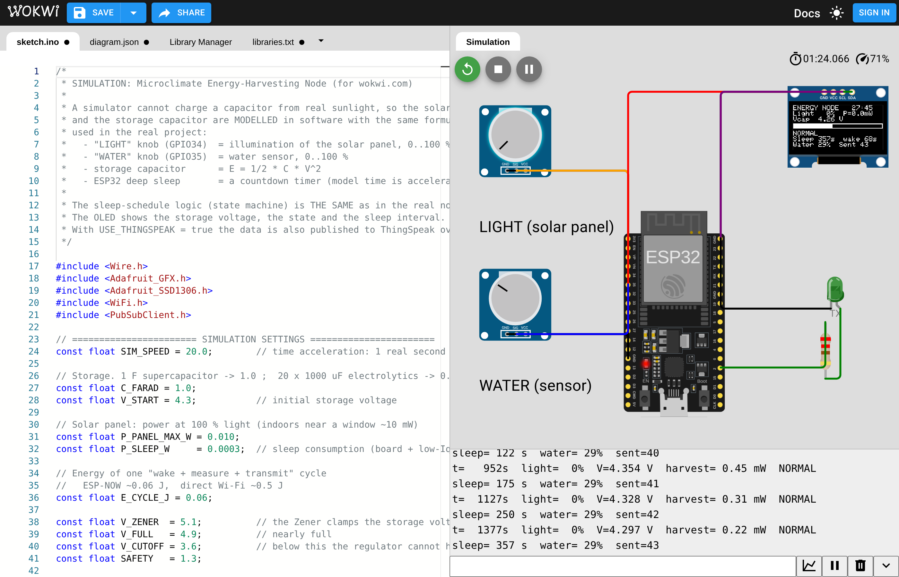

# Microclimate Energy-Harvesting Node

**A self-sustaining indoor monitoring node: an ESP32 powered only by a small 5 V solar panel and a capacitor bank, with an adaptive sleep schedule that maximises telemetry frequency without draining the storage.**

> **Research question:** *What sleep schedule maximises telemetry frequency without draining small (super)capacitors?*
>
> **Short answer:** an **adaptive** one. The node measures how much energy the panel delivered while it slept and sets the next sleep interval to
> `interval = 1.3 × E_cycle / P_harvest`, so it spends only about 75 % of what it harvests. A four-state machine (HARVEST_ONLY / LOW / NORMAL / RICH) handles the edge cases.

<!-- TODO (author): replace with a photo of the assembled breadboard -->


**Video demonstration:** _link to be added_

---

## Contents

- [How it works](#how-it-works)
- [Hardware](#hardware)
- [Repository structure](#repository-structure)
- [Setup and replication](#setup-and-replication)
- [Simulation (Wokwi)](#simulation-wokwi)
- [Results](#results)
- [Outcomes and lessons learned](#outcomes-and-lessons-learned)

---

## How it works



The panel trickle-charges a capacitor bank. The ESP32 sleeps almost all the time (deep sleep), wakes for a fraction of a second, measures, sends one packet and sleeps again. The interesting part is **how long to sleep**.

### Duty cycle of the node

1. Wake up from deep sleep (the sketch restarts from `setup()`).
2. Measure the storage voltage `V` through a 1 MΩ / 1 MΩ divider (GPIO34).
3. Estimate the harvested power from the voltage gained during the last sleep:
   `P_harvest = ½·C·(V_now² − V_before²) / t_sleep`
4. Compute the usable energy `E = ½·C·(V² − V_cutoff²)` and pick a state.
5. Compute the next sleep interval.
6. Power the water sensor from GPIO25 for ~10 ms and read it on GPIO35.
7. Send one ESP-NOW packet to the gateway.
8. Store the voltage in RTC memory and go back to deep sleep.

### State machine

| State | Condition | Behaviour |
|---|---|---|
| `HARVEST_ONLY` | usable energy < 1.5 × one cycle | do not transmit, just sleep and charge |
| `LOW` | usable energy < 3 × one cycle | transmit, but sleep twice as long |
| `NORMAL` | otherwise | `interval = 1.3 × E_cycle / P_harvest` |
| `RICH` | storage ≥ 4.9 V (full) | transmit at the minimum interval (15 s): surplus energy would be burnt in the Zener anyway |

A brown-out reset is treated as "the last cycle ran out of energy": the node skips the work and sleeps to recharge.

### Why ESP-NOW and a gateway

One Wi-Fi connection costs roughly 0.3–1 J. One ESP-NOW broadcast costs roughly 0.05 J, **10–20× less**, so the same harvested power allows 10–20× more frequent telemetry and a much smaller storage. A second, USB-powered ESP32 (the gateway) receives the packets and publishes them to ThingSpeak over MQTT.

More detail and the full energy budget: [docs/how_it_works.md](docs/how_it_works.md).

---

## Hardware

| Part | Purpose |
|---|---|
| ESP32 dev board × 2 | node and gateway |
| Solar panel 5–6 V, 1–2 W | energy source |
| Storage: electrolytic capacitors 1000 µF 16–25 V in parallel (or 2 × 2.7 V 5 F supercapacitors in series) | energy buffer |
| Schottky diode 1N5819 | stops the storage discharging back through the panel |
| Zener diode 1N4733A (5.1 V, 1 W) | over-voltage clamp for the storage |
| 3.3 V LDO regulator (low quiescent current, e.g. HT7333 / ME6211) | supply for the ESP32 |
| Electrolytic capacitor 1000 µF | buffers the radio current peaks on the 3.3 V rail |
| 2 × 1 MΩ resistors, 100 nF capacitor | storage-voltage divider for the ADC |
| Water level sensor (S, +, −) | the measured quantity |
| INA219 module (optional) | measuring current / energy per cycle |

Full bill of materials with notes: [hardware/BOM.md](hardware/BOM.md)
Step-by-step wiring (including soldering the panel leads): [hardware/wiring.md](hardware/wiring.md)

### Pin map (node)

| ESP32 pin | Connected to |
|---|---|
| 3V3 | LDO output (3.3 V rail) |
| GND | common ground |
| GPIO34 (ADC1) | middle of the 1 MΩ / 1 MΩ divider on VCAP |
| GPIO25 | water sensor `+` (powered only while measuring) |
| GPIO35 (ADC1) | water sensor `S` |

3D models: not applicable — the project has no custom mechanical parts.

---

## Repository structure

```
.
├── README.md
├── firmware/
│   ├── node_espnow_water/      node: deep sleep + adaptive schedule + ESP-NOW
│   ├── gateway_espnow_mqtt/    gateway: ESP-NOW -> ThingSpeak MQTT
│   └── node_wifi_bme280/       alternative single-board node: direct Wi-Fi, BME280, supercapacitor
├── simulation/wokwi/           software model of the node for wokwi.com
├── hardware/
│   ├── BOM.md
│   ├── wiring.md
│   └── schematics/             breadboard wiring diagram
├── docs/
│   ├── how_it_works.md         energy budget and algorithm
│   ├── results.md              simulation and hardware results
│   ├── simulation_log.txt      raw serial log of a simulation run
│   └── images/
└── photos/                     photos of the real build
```

---

## Setup and replication

**Tools:** Arduino IDE 2.x with the *esp32 by Espressif Systems* board package (tested with core 3.x), library **PubSubClient** (gateway only).

### 1. ThingSpeak

1. Create a channel with 8 fields: water raw, water %, storage voltage, sleep interval, harvested power (mW), state, node wake-up counter, packets received.
2. *Devices → MQTT → Add a new device*, authorise it for the channel, and note the Client ID, Username and Password.

### 2. Gateway

1. Open `firmware/gateway_espnow_mqtt/gateway_espnow_mqtt.ino`.
2. Fill in `WIFI_SSID`, `WIFI_PASS`, the three MQTT values and `CHANNEL_ID`.
3. Upload to the second ESP32, open the Serial Monitor (115200 baud).
4. Note the line `>>> Wi-Fi channel: N`.

### 3. Node — bench test on USB

1. Open `firmware/node_espnow_water/node_espnow_water.ino`.
2. Set `WIFI_CHANNEL` to the number printed by the gateway and `TEST_MODE = true`.
3. **Disconnect the 3V3 wire from the regulator** while the board is on USB, then upload.
4. The node now sends every 20 s. Check that the gateway prints `Packet #…` and ThingSpeak receives data.
5. Dip the water sensor fully, read the raw value, and put it into `WATER_FULL` in the gateway sketch.

### 4. Node — solar operation

1. Set `TEST_MODE = false`.
2. Set `N_CAPS` to the number of 1000 µF capacitors in the storage bank.
3. Set `V_CUTOFF` for your regulator (4.5 for AMS1117, 3.6 for HT7333 / ME6211).
4. Measure the energy of one cycle (INA219) and put it into `E_CYCLE_J`.
5. Upload, unplug USB, reconnect the 3V3 wire and put the panel in the light.

If an upload fails with `Failed to connect`, the board is probably asleep: hold **BOOT** while the IDE shows `Connecting…`.

---

## Simulation (Wokwi)

A simulator cannot charge a capacitor from light, so `simulation/wokwi` contains a **software model**: the panel and the capacitor are computed with the same formulas, and the sleep-schedule logic is identical to the real node. Model time runs 20× faster than real time.

| Part in Wokwi | Represents |
|---|---|
| LIGHT knob (GPIO34) | illumination of the solar panel, 0–100 % |
| WATER knob (GPIO35) | water sensor |
| OLED | storage voltage, charge bar, state, sleep interval |
| Green LED | blinks on every transmission |

How to run it: [simulation/wokwi/README.md](simulation/wokwi/README.md)



---

## Results

### Simulation (model: 1 F storage, 10 mW panel at 100 % light, 0.06 J per cycle)

| Light | Harvest estimate | State | Sleep interval chosen by the node |
|---|---|---|---|
| 50 % | 4.7 mW | NORMAL | **16 s** (formula: 1.3 × 0.06 J / 4.7 mW = 16.6 s) |
| 0 % (knob turned down) | decays 3.8 → 0.2 mW | NORMAL | grows **20 → 29 → 42 → 60 → 85 → 122 → 175 → 250 → 357 s** |

In the dark the storage voltage fell only from 4.46 V to 4.30 V in 13 minutes of model time, because the node stretched its own interval instead of continuing to transmit. Raw log: [docs/simulation_log.txt](docs/simulation_log.txt).

### Hardware

_Measurements on the real breadboard are to be added: see the tables in [docs/results.md](docs/results.md)._

---

## Outcomes and lessons learned

- **The telemetry rate is limited by the energy of one transmission, not by the size of the storage.** The storage only has to hold a few cycles; the average rate is `P_harvest / E_cycle`.
- **A fixed schedule is always wrong somewhere:** too slow in good light, fatal in bad light. Estimating the harvest from the storage voltage needs no extra hardware and adapts automatically.
- **The regulator's own current matters more than anything else.** An AMS1117 draws about 5 mA by itself (≈ 25 mW at 5 V), more than a small panel delivers indoors. A low-quiescent-current LDO (HT7333, ME6211) is required for real energy harvesting.
- **Ordinary electrolytic capacitors store very little energy** (a 1000 µF capacitor gives a few millijoules between 5.1 V and the cutoff), so direct Wi-Fi is impossible with them; ESP-NOW makes the design feasible.
- Powering the sensor from a GPIO only while measuring saves energy and slows electrode corrosion.

---

## Report

Project proposal and final analysis (PDF): [docs/report/Proposal_and_Analysis_Artykova_Aibiike.pdf](docs/report/Proposal_and_Analysis_Artykova_Aibiike.pdf)

---

## Author

**Artykova Aibiike** — group EEAIR-25
Instructor: Mr. Tauheed
