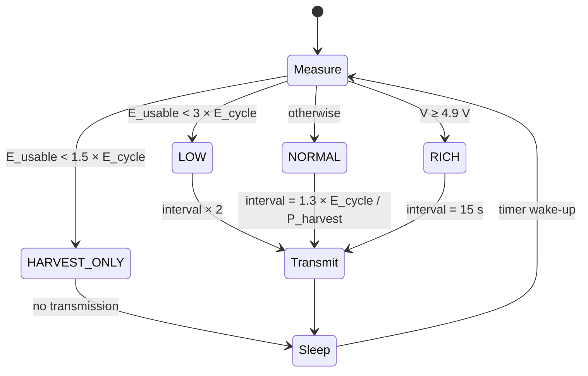

# How it works: energy budget and algorithm

## 1. The problem

A small 5 V panel indoors delivers milliwatts. An ESP32 with its radio on needs hundreds of milliwatts. The node can therefore only work in short bursts, powered from a storage capacitor that the panel refills slowly. The question is how often it may wake up.

## 2. Energy in the storage

```
E = ½ · C · V²
```

Only part of it is usable: the regulator needs a minimum input voltage `V_cutoff` to keep 3.3 V on its output, and the Zener clamps the top at about 5.1 V.

```
E_usable = ½ · C · (V² − V_cutoff²)
```

| Storage | C | Usable energy 4.9 V → 3.6 V | Wi-Fi cycles (~0.5 J) | ESP-NOW cycles (~0.05 J) |
|---|---|---|---|---|
| 1 × 1000 µF | 0.001 F | 0.006 J | 0 | 0 |
| 10 × 1000 µF | 0.01 F | 0.055 J | 0 | 1 |
| 20 × 1000 µF | 0.02 F | 0.11 J | 0 | 2 |
| 10 × 4700 µF | 0.047 F | 0.26 J | 0 | 5 |
| 2 × 5 F supercapacitors in series | 2.5 F | 13.8 J | ~27 | ~270 |

Ordinary electrolytic capacitors cannot power even one Wi-Fi connection, which is why the node uses ESP-NOW.

## 3. Energy balance

For the storage not to drain, the energy harvested during one sleep period must cover one active cycle:

```
P_harvest · t_sleep  ≥  E_cycle
t_sleep  ≥  E_cycle / P_harvest
```

`P_harvest` here is the *net* power that actually charges the storage during sleep (panel power minus sleep losses of the board, the regulator, the divider and capacitor leakage).

The firmware uses a 30 % margin:

```
t_sleep = 1.3 · E_cycle / P_harvest
```

Examples for `E_cycle = 0.06 J` (ESP-NOW):

| Net harvested power | Sleep interval |
|---|---|
| 0.5 mW | 156 s |
| 2 mW | 39 s |
| 4.7 mW | 16 s |
| 10 mW | 7.8 s → limited to 15 s |

The same panel with direct Wi-Fi (`E_cycle ≈ 0.5 J`) would allow only one message every 2–20 minutes.

## 4. Measuring the harvested power without extra hardware

The node already measures the storage voltage. Before it goes to sleep it stores the voltage `V_before` and the planned sleep time in RTC memory (which survives deep sleep). After waking up:

```
P_harvest = ½ · C · (V_now² − V_before²) / t_sleep
```

The value is smoothed with an exponential moving average (70 % old, 30 % new) so that a single shadow on the panel does not upset the schedule.

A useful side effect: when it gets dark the measured gain is zero or negative, the average decays step by step, and the sleep interval grows automatically.

## 5. State machine



- **HARVEST_ONLY** protects against brown-outs: transmitting with too little energy would reset the board in the middle of the cycle and waste the charge.
- **RICH** exists because a full storage cannot accept more energy: everything the panel delivers above 5.1 V is burnt in the Zener, so it is better to spend it on telemetry.
- The interval is always limited to 15 s … 30 min. 15 s is the ThingSpeak rate limit.

## 6. Where the energy goes in one cycle

| Phase | Typical duration | Typical current |
|---|---|---|
| Boot after deep sleep | 150–300 ms | 30–50 mA |
| Sensor (powered from a GPIO) | 10 ms | few mA |
| ESP-NOW transmission | 20–50 ms | 100–200 mA |
| Deep sleep | the rest | 10 µA – a few mA depending on the board and regulator |

With a linear regulator the current comes from the storage at the storage voltage, so the energy taken from the capacitor is `V_cap · I · t`, not `3.3 V · I · t`.

These are typical figures; the real `E_cycle` must be measured (INA219 between the regulator and the ESP32) and written into the firmware.

## 7. Design choices that save energy

| Choice | Effect |
|---|---|
| ESP-NOW broadcast instead of Wi-Fi + MQTT on the node | 10–20× less energy per message |
| Broadcast address | no pairing, no acknowledgement wait |
| Sensor powered from GPIO25 only while measuring | no standby current, less corrosion |
| 1 MΩ / 1 MΩ divider | only 2.5 µA through the divider |
| Low-quiescent-current LDO | sleep losses below the harvested power |
| Schottky diode | low forward drop, storage cannot discharge into the panel |
