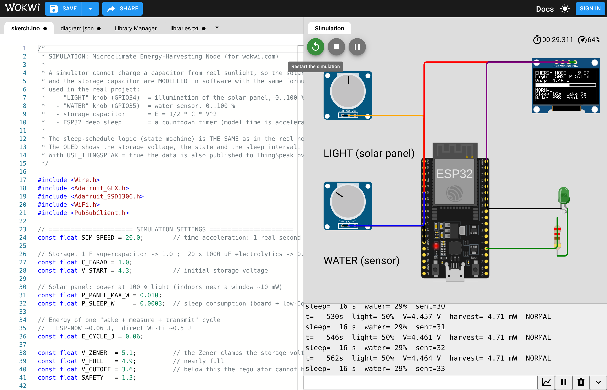
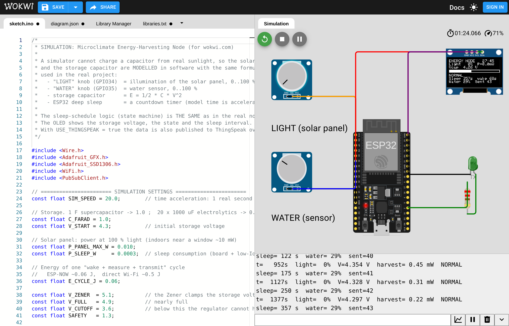

# Results

## 1. Simulation (Wokwi)

Model parameters: storage 1 F, panel 10 mW at 100 % light, sleep losses 0.3 mW, 0.06 J per cycle, time accelerated 20×.
Raw serial log of the run: [simulation_log.txt](simulation_log.txt).

### Light 50 % (panel 5 mW)

| Model time | Storage voltage | Harvest estimate | State | Sleep interval |
|---|---|---|---|---|
| 65 s | 4.357 V | 4.70 mW | NORMAL | 16 s |
| 353 s | 4.419 V | 4.71 mW | NORMAL | 16 s |
| 578 s | 4.468 V | 4.71 mW | NORMAL | 16 s |

The node transmits every 16 s and the voltage still rises slowly: it spends about 75 % of the harvested energy, as designed.

### Light turned down to 0 %

| Model time | Storage voltage | Harvest estimate | Sleep interval |
|---|---|---|---|
| 594 s | 4.460 V | 3.79 mW | 20 s |
| 614 s | 4.445 V | 2.65 mW | 29 s |
| 643 s | 4.430 V | 1.86 mW | 42 s |
| 685 s | 4.413 V | 1.30 mW | 60 s |
| 745 s | 4.396 V | 0.91 mW | 85 s |
| 830 s | 4.376 V | 0.64 mW | 122 s |
| 952 s | 4.354 V | 0.45 mW | 175 s |
| 1127 s | 4.328 V | 0.31 mW | 250 s |
| 1377 s | 4.297 V | 0.22 mW | 357 s |

Without any light sensor the node notices that the storage stopped charging and stretches its interval from 16 s to almost 6 minutes within 13 minutes of model time, losing only 0.16 V.

## 2. Hardware measurements

<!-- TODO (author): fill in with real measurements from the breadboard -->

### 2.1 Energy per cycle and sleep current (INA219)

| Quantity | Measured value |
|---|---|
| Sleep current of the node (with the regulator) | |
| Peak current during transmission | |
| Duration of one active cycle | |
| Energy of one cycle `E_cycle` | |

### 2.2 Regulator comparison

| Regulator | Sleep current | Does the storage charge indoors? |
|---|---|---|
| AMS1117-3.3 | | |
| HT7333 | | |

### 2.3 Behaviour under different light

| Light condition | Storage voltage | Harvested power (field 5) | State | Sleep interval (field 4) |
|---|---|---|---|---|
| Next to a window, daytime | | | | |
| Under a desk lamp | | | | |
| Room light only | | | | |
| Dark | | | | |

### 2.4 Water sensor calibration

| Depth | Raw ADC value |
|---|---|
| Dry | |
| Tip in water | |
| Half submerged | |
| Fully submerged (`WATER_FULL`) | |
