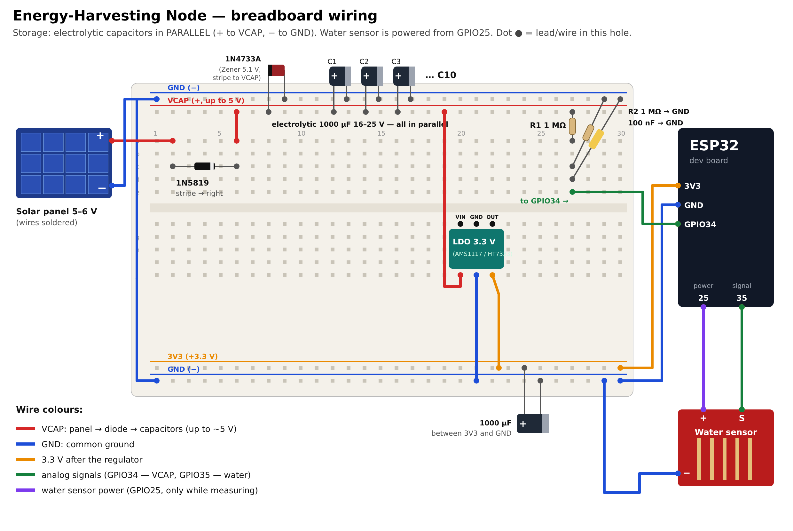

# Wiring, step by step

Rails used on the breadboard:

| Rail | Name | Meaning |
|---|---|---|
| top red | **VCAP** | storage capacitors, up to about 5 V |
| top blue | **GND** | common ground |
| bottom red | **3V3** | regulator output |
| bottom blue | **GND** | common ground (linked to the top one) |

## 1. Solder the panel leads

1. Find the `+` and `−` pads on the back of the panel. If they are not marked, put the panel in the light and check the polarity with a multimeter (DC volts).
2. Cut one plug off a red and a black male jumper wire, strip 5 mm, twist and tin the ends. Keep the other pin: it goes into the breadboard.
3. Tin the pads, then solder red to `+` and black to `−`. Keep the iron on the pad for 2–3 s only.
4. Fix the wires with tape or hot glue as strain relief.
5. In the light, the voltage between the two pins should be about 5–6.5 V.

## 2. Storage side

Cover the panel (or turn it face down) while assembling.

| Step | Part | Where |
|---|---|---|
| 1 | Jumper | top GND rail ↔ bottom GND rail |
| 2 | Panel, black wire | top GND rail |
| 3 | Panel, red wire | hole 2a |
| 4 | Schottky 1N5819 | 2c → 6c, **stripe on the 6c side** |
| 5 | Jumper | 6a → VCAP rail |
| 6 | Zener 1N4733A | VCAP rail → GND rail, **stripe on the VCAP side** |
| 7 | Storage capacitors | each one: long lead (+) in VCAP, striped side (−) in GND, all in parallel |

## 3. Regulator and 3.3 V rail

| Step | Part | Where |
|---|---|---|
| 8 | LDO regulator | VIN, GND, OUT in 20f, 21f, 22f (check the pinout of your part) |
| 9 | Jumper | 20j → VCAP rail |
| 10 | Jumper | 21j → bottom GND rail |
| 11 | Jumper | 22j → 3V3 rail |
| 12 | Electrolytic 1000 µF | + in 3V3 rail, − in bottom GND rail |

## 4. Voltage divider for the ADC

| Step | Part | Where |
|---|---|---|
| 13 | R1 1 MΩ | VCAP rail → 27a |
| 14 | R2 1 MΩ | 27c → GND rail |
| 15 | 100 nF ceramic | 27d → GND rail |

## 5. Check before connecting the ESP32

Uncover the panel, wait a minute or two, and measure with a multimeter:

| Point | Expected |
|---|---|
| VCAP rail to GND | 4.5–5.1 V (if above 5.3 V the Zener is reversed) |
| 3V3 rail to GND | 3.2–3.4 V |
| 27e to GND | about half of VCAP |

## 6. ESP32 and sensor

| Step | From | To |
|---|---|---|
| 16 | 3V3 rail | ESP32 `3V3` |
| 17 | bottom GND rail | ESP32 `GND` |
| 18 | 27e | ESP32 `GPIO34` |
| 19 | ESP32 `GPIO25` | water sensor `+` |
| 20 | ESP32 `GPIO35` | water sensor `S` |
| 21 | GND rail | water sensor `−` |

**Important**

- Disconnect wire 16 (3V3) whenever the ESP32 is connected to USB, so that two supplies never fight.
- Electrolytic capacitors and the Zener are polarised: a reversed capacitor can be destroyed.
- Cold start: with an empty storage the ESP32 may get stuck in a reset loop. Let the storage charge to about 4.5 V before connecting wire 16.
- To measure the consumption, put an INA219 in series with wire 16 (`VIN+` to the 3V3 rail, `VIN−` to the ESP32 `3V3` pin).
